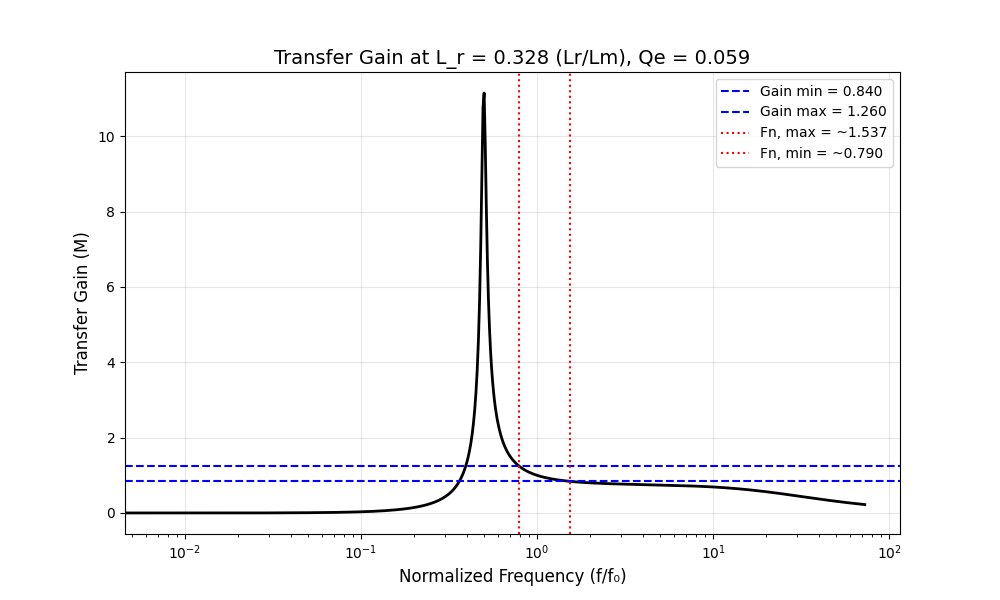
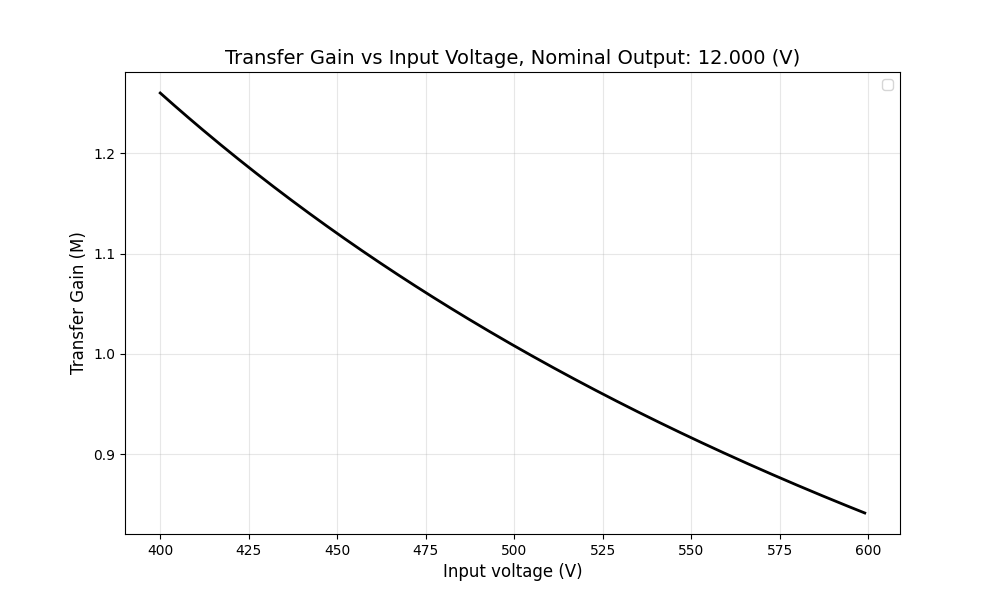
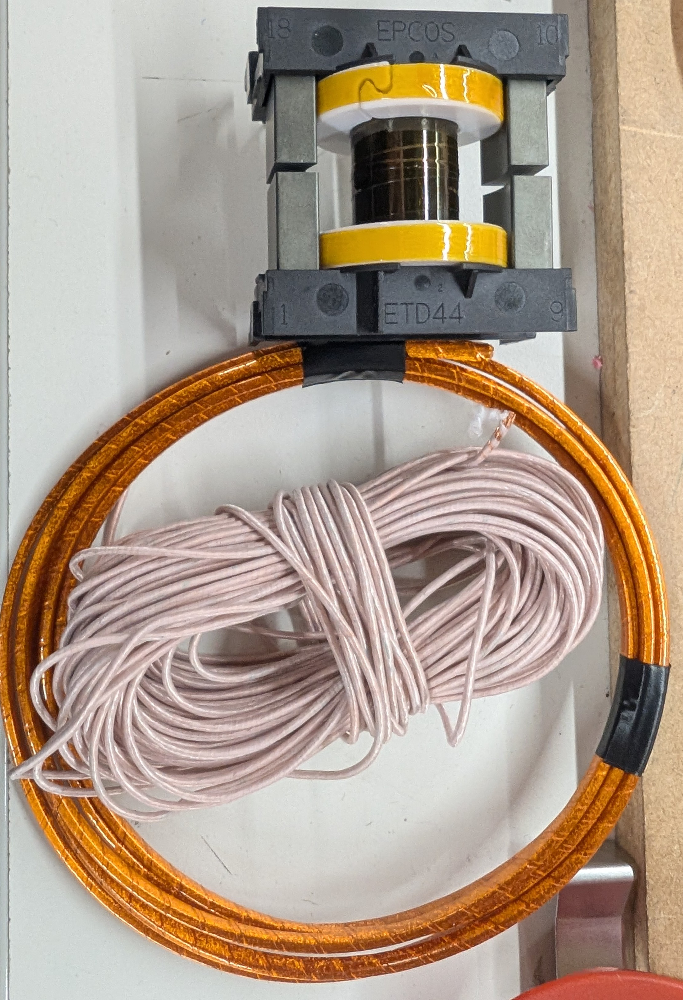
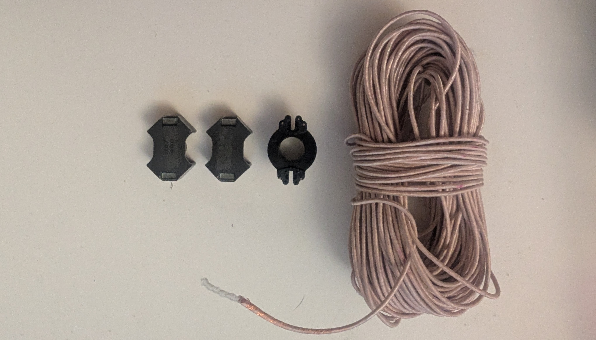

<!--
Colors:
FFFFFF - Pure white
e01e37 - Bold crimson-red 

Hello,
I enjoyed working with others for once, and being able
to have my own architecturally defined piece in the 
car is pretty damn cool.

- William Bowley, 2026-08-17

P.S: 
Thanks for downloading the APU repository `▽`ʃ♡ — but please be safe with high-voltage boards :)

-->


<div align="center">
  

  A proposed low-voltage grounded APU for FSAE-A vehicles <br>
</div>

### Overview

The APU is a proposed power architecture that allows the tractive battery, while connected, to feed the low-voltage grounded (LVG) system via 
an isolated LLC converter, using the LVG battery as a line buffer. The LVG battery also allows for standby mode while the tractive battery is disconnected.

### Objectives

```
- [/] Support a `400-600 V` input range from the tractive battery.
- [/] Support up to `300 W (DC)` continuous loads and `800 W (DC)` peak transient loading.
- [/] Reach an asymptote temperature under `70°C` with passive cooling.
- [ ] Validate the APU architecture and generate performance curves.
- [ ] Pass the EMC/EMI requirements and pass the 2027 Formula SAE rules inspection.
```

> *(Note). `[ ]` Not started. `[/]` In progress. `[x]` Complete.*

---

### Simulations

All simulations are written in `Python` and use `picounits` for parameter loading and unit validation at defined boundaries.

#### First Harmonic Approximation

This model uses the resonant circuit two-port model described in application note `AN2450` by ST and also in a `2024 RMIT` paper, though they use different models. The ST FHA model was used in this implementation, as the exact gain characteristic function isn't defined in the RMIT paper.

<div align="center">
  
  <br>
  <em>FHA using values similar to the 2024 RMIT paper.</em>
</div>

#### Transfer Gain

This model calculates the transfer gain over a specific input voltage range into the converter to achieve a nominal fixed output voltage using a gain equation based on
transformer ratio.

<div align="center">
  
  <br>
  <em>Transfer gain over 600-400 V with nominal output voltage of 12 V.</em>
</div>

<br>

See [`01_simulation`](./01_simulation/) for more details.

---

### Magnetic Passives

> *(Ordered). The formers and cores are on-hand, along with the litz wire. However, we are waiting on the PTFE sleeve.*

An attempt was made to use `FEM` to solve the problem using magnetostatics to define field density, self- and mutual inductance. 
However, due to these components being loosely coupled to one another, the decision was made to design around ensuring isolation, 
that the core doesn't saturate, and that the current density matches the litz wire chosen. After which, the passives can be made 
and then measured using an LCR meter, ultimately being reduced to LCR parameters for first harmonic analysis.

#### Transformer

The transformer used for this design has an `N87` core with a `glass fibre` coil former and snap-on `ABS` insulation rings. 
The turns ratio is `21:1:1`, with `0.15 mm × 60` litz wire used on the primary with a PTFE sleeve across 3 layers of 14 turns each. 
The secondary and tertiary windings each have a single layer of 2 turns with `0.05 mm × 1740` litz wire. Each layer is wrapped in `0.1 mm`
polyimide tape.

<div align="center">
  
  <br>
  <em>Transformer core/former with litz wire.</em>
</div>

#### External Inductor

The external inductor used for this design has an `N87` core with a `glass fibre` coil former, and uses the same litz wire (`0.15 mm × 60`) as the transformer primary. 
The number of turns within the inductor is dependent on the transformer's characteristics.

<div align="center">
  
  <br>
  <em>Inductor core/former with litz wire.</em>
</div>

<br>

See the [`02_passives`](./02_passives/readme.md) for implementation details.

---

### LLC Boards

#### LLC High Voltage Side (LLC-HVS)

> *(Work in progress). This board is currently being designed in altium*

This board uses the `UCC25600DRG4` resonant mode controller to control the LLC half-bridge via the `ISO7720DWVR` for digital isolation. 
The half-bridge itself is built around the `IR2214SSPBF` with two `E3M0075120K` FETs. 
This board also contains the resonant network and the primary side of the transformer.

```
Resonant Controller (UCC25600DRG4)
              ↓
Digital Isolator (ISO7720DWVR)
              ↓
Half Bridge Driver (IR2214SSPBF) → FETs (E3M0075120K)
              ↓
Resonant Network (Series Capacitor, Inductor & Transformer Primary)
```

#### LLC Low Voltage Side (LLC-LVS)

> *(Dependency). This board is currently paused until the LLC-HVS is finished.*

<br>

See the [`03_boards`](./03_boards/readme.md) for implementation details.

---

### APU Battery & APU Packaging

> *(Dependency). The APU battery & Packaging is dependent on the implementation of the LLC Boards.*

The proposed battery type for the APU battery is a `3-4s` LiPo pack in series to achieve the required 12 V. 
LiPo batteries tend to have a high C-rating, hence they can buffer higher peak transients. 
The battery is ultimately intended to be packaged below the LLC converter boards and may require a specific `APU-BI` board.

<br>

see [`04_integration`](./04_integration/) for details.

---

### Documentation

Each section of the repo is self-documenting. <br>
For internal documentation, credits, and contributors, refer to [`00_docs`](./00_docs/readme.md).

### Bibtex

```
@misc{APU_2026,
  author = {William Bowley},
  title = {APU: A Proposed Low-Voltage Grounded Auxiliary Power Unit for FSAE-A Vehicles},
  url = {https://github.com/rmit-wgbowley/APU},
  year = {2026},
  note = {GitHub repository},
  license = {CERN Open Hardware Licence Version 2}
}
```

---


